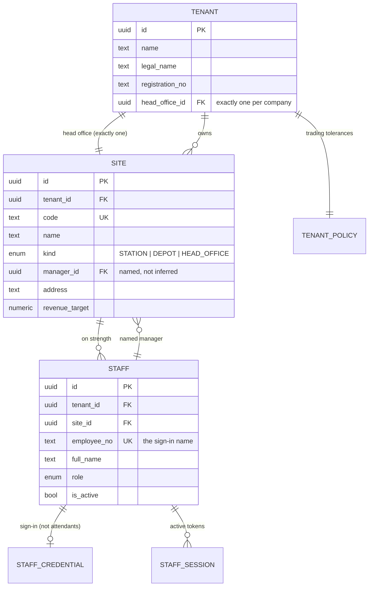
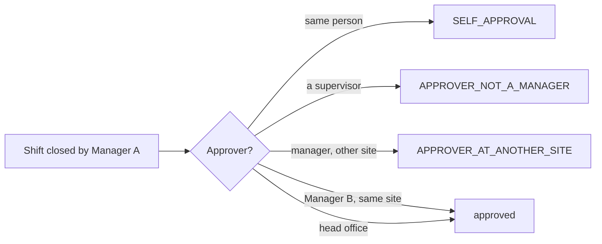
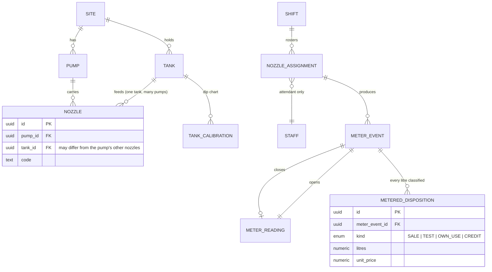
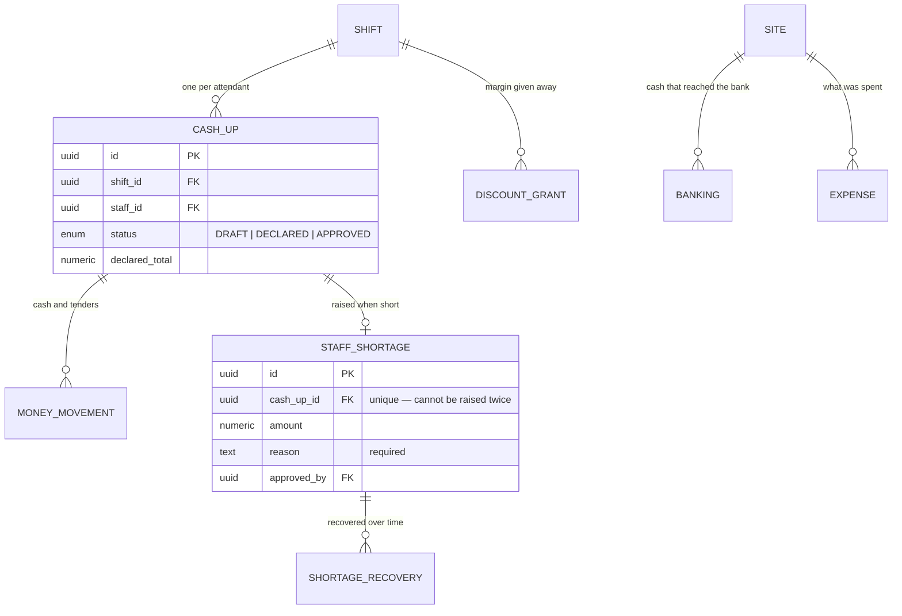
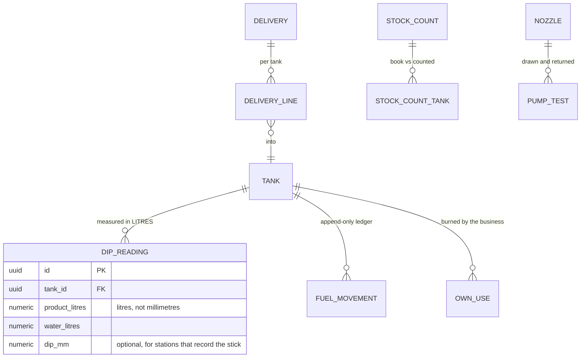
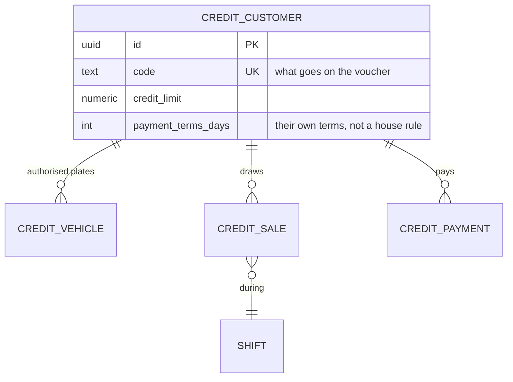

# FCMS — the schema, and why it is shaped this way

Sixty tables is a lot to hold in your head, so this is the map. It is grouped
by what each cluster is *for*, and it says which relationships carry a rule
rather than just a foreign key — because those are the ones that will bite you
if you work around them.

---

## The organisation

**Why `tenant` and not `company`.** It already holds a company's identity and
its trading policy, and renaming it would touch every RLS policy, every
function and every test for no gain. It *is* the company.

**Why head office is a site.** Staff attach to sites and permissions scope to
sites; a separate org-unit table would mean two code paths for both. It is a
`kind` instead — and three triggers make the difference real rather than
nominal: a head office may hold no tank, no pump and no shift.

**Why `site.manager_id` exists** when you could derive it from staff. The
dashboard query used to reach for *any* active manager at the site, so a site
with two managers named a different person on each refresh. Responsibility is a
fact about the site, not something to infer from a list.

### Who may create whom

| Role | May create | May not |
|---|---|---|
| `SYSTEM_ADMIN` | companies, head offices, sites, anyone | — |
| `HEAD_OFFICE` | managers, accountants, supervisors, attendants | system admins |
| `MANAGER` | supervisors, attendants | **another manager** |
| `SUPERVISOR` | — | — |

A manager cannot appoint another manager, and that is the whole point: **the
second manager is who approves the first one's shifts.** A control that lets
the controlled party choose their own reviewer is not a control.

### Who may approve a shift

The old rule required only that the two people **differ** — which a supervisor
and a manager satisfy. A supervisor approving their own supervisor's cash-up is
exactly the arrangement segregation of duties exists to prevent. The letter
held; the intent did not.

A site with one manager therefore cannot approve its own shifts. That is the
finding, not a bug: appoint a second manager, or let head office approve.
`v_site_approval_readiness` says which sites are in that position.

---

## The forecourt

**A nozzle belongs to a pump and to a tank, separately.** A pump may carry one
nozzle or four, and one tank may feed nozzles on several pumps. Modelling
throughput per *pump* is the classic mistake — it under-counts a shared tank
and is why some systems cannot reconcile a forecourt at all.

**Every litre is classified.** `metered_disposition` rows must sum to the meter
event's gross litres, checked at commit. Fuel that moved and was never
accounted for cannot be saved: not as a sale, not as a test draw, not as
own-use.

**An attendant cannot author a reading.** `meter_reading.recorded_by` carries a
composite foreign key that only non-attendant staff satisfy. Structural, not a
convention — there is no code path around it.

---

## Money

**An unallocated shilling cannot close a shift.** The gap becomes a named
receivable against a named person with a stated reason, or the shift does not
close. There is no third option, and that is the single most valuable rule in
the system.

**Wages cannot be docked without a signed acknowledgement** —
`shortage_recovery` refuses a salary deduction without one.

**Money movements are append-only.** A rule discards UPDATE silently rather
than erroring, which is deliberate: an append-only ledger that throws teaches
people to avoid it.

---

## Wet stock

**Dips are in litres.** The operator reads the stick, looks the volume up on
the chart on the office wall, and the figure they carry to the office *is* the
litres. Asking for millimetres so the server can redo that lookup adds a step
and makes every number depend on a calibration chart that shipped as a straight
line — and a real tank is a cylinder, so a straight line is wrong at both ends,
which is exactly where tanks sit: just after a delivery and just before one.

---

## Credit

**Two simultaneous sales cannot both pass the limit.** `fn_customer_headroom()`
reads under `FOR UPDATE`, so the second waits for the first. Without the lock
both read the same headroom and both pass — which is how a customer with a
15,000,000 limit ends up owing 22,000,000 by lunchtime.

---

## Control

| Table | What it guarantees |
|---|---|
| `exception_flag` | Everything the system refused to let pass quietly, and whether anyone answered it |
| `audit_log` | Append-only, including for the unrestricted role |
| `idempotency_record` | A retried write does not become two writes |
| `role_permission` | Manager holds everything a supervisor holds, enforced by trigger |

**Row-level security is the tenant boundary**, and it is verified as `fcms_app`
rather than as a superuser. An earlier version of those tests ran as superuser,
which bypasses RLS entirely — they passed while proving nothing.

---

## Reading this against the code

- Tables and rules: `db/migrations/*.sql`, numbered in dependency order
- The rules as assertions: `db/test/integrity.sql` — **54 tests**
- `./verify.sh` checks every query in the C# resolves against this schema
